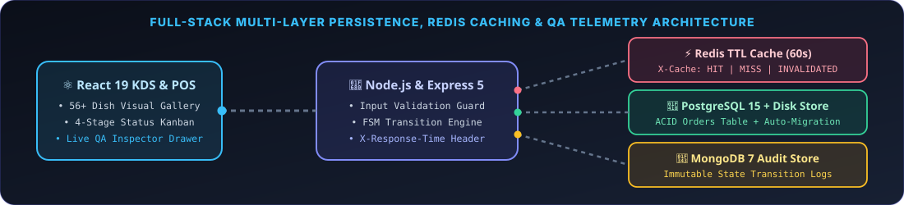
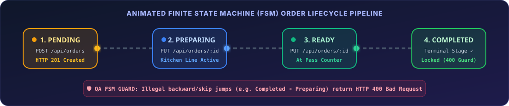
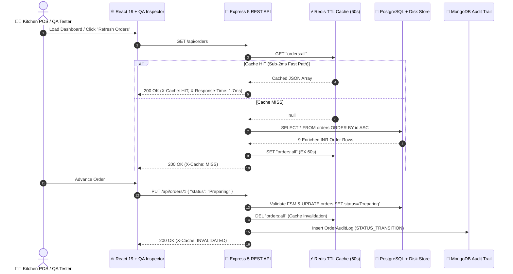

<div align="center">

<!-- Animated Custom SVG Hero Banner -->


<br />

<!-- Animated Typing Headline (GitHub Readme Typing SVG) -->
<a href="https://git.io/typing-svg">
  
</a>

<br />

<!-- Tech Stack & QA Status Badges -->


-F59E0B?style=for-the-badge)

<br />

[**✨ Live Features**](#-1-enterprise-features--visual-pos-highlights) •
[**🍛 56+ Dish Menu (₹ INR)**](#-2-visual-56-dish-culinary-catalog--indian-currency--inr) •
[**🔄 Animated FSM Pipeline**](#-3-finite-state-machine-fsm-order-lifecycle) •
[**🛠️ QA Inspector & Tests**](#-4-software-testing--qa-automation-readiness) •
[**🚀 Quick Start**](#-5-quick-start--installation)

</div>


## ✨ 1. Enterprise Features & Visual POS Highlights

**GourmetFlow** is a full-stack **Restaurant Order Tracker, Visual Point-of-Sale (POS), and QA Automation Platform** engineered to demonstrate production-grade software quality, strict state-machine validation, multi-database synchronization, and real-time API telemetry.

<div align="center">
  
</div>

| Module | Key Capabilities | QA & Engineering Value |
| :--- | :--- | :--- |
| **🍽️ 56+ Dish Visual Gallery** | High-res dish photos across **Breakfast, Lunch, Dinner, Starters, Fresh Juices, Milkshakes & Desserts** with `🟢 Veg` / `🔴 Non-Veg` filters & `₹` INR pricing. | Tests rich media rendering, SVG fallback resilience, and multi-criteria filtering. |
| **📋 4-Stage Status Kanban & Grid** | Interactive columns (**`Pending` ➔ `Preparing` ➔ `Ready` ➔ `Completed / Cancelled`**) with live column `₹` subtotals, 4-segment progress bars, and 1-click view toggle to **Table Grid**. | Validates UI state synchronization and deterministic DOM updates. |
| **🛠️ Toggleable QA Inspector** | Live engineering drawer displaying **API Latency (`ms`)**, **HTTP Status Badges**, **`X-Cache: HIT \| MISS \| INVALIDATED`**, **Last Request/Response JSON**, and **1-Click Negative QA Probes**. | Built specifically to demonstrate live API & cache inspection during QA interviews. |
| **🛡️ Zero-Dependency DB Fallback** | Connects to live **PostgreSQL**, **MongoDB**, and **Redis** when available, and seamlessly engages a **Persistent Disk (`orders_store.json`) + In-Memory Engine** if any daemon is offline. | Guarantees **0% crash rate** and instant startup (`npm start`) on any machine. |


## 🍛 2. Visual 56-Dish Culinary Catalog & Indian Currency (`₹` INR)

Every price across the frontend, backend, database schema, and seeded orders is formatted in **Indian Rupees (`₹` / INR)** using `Intl.NumberFormat('en-IN')`. Every dish card features high-resolution photography with an automatic dynamic SVG artwork fallback (`getFallbackDishSvg`) so broken image icons can never occur.

<div align="center">

| ☀️ Breakfast | 🍛 Lunch & Thalis | 🌙 Dinner & Grill | 🍹 Juices & 🥤 Milkshakes |
| :---: | :---: | :---: | :---: |
|  |  |  |  |
| **Mysore Masala Dosa**<br/>`🟢 Veg` • **`₹240`** • `★ 4.9` | **Hyderabadi Dum Biryani**<br/>`🔴 Non-Veg` • **`₹380`** • `★ 5.0` | **Butter Chicken & Naan**<br/>`🔴 Non-Veg` • **`₹420`** • `★ 5.0` | **Belgian Chocolate Shake**<br/>`🟢 Veg` • **`₹240`** • `★ 5.0` |
|  |  |  |  |
| **Amritsari Chole Bhature**<br/>`🟢 Veg` • **`₹260`** • `★ 4.9` | **Maharaja Veg Thali (12)**<br/>`🟢 Veg` • **`₹460`** • `★ 4.9` | **Tandoori Kebab Platter**<br/>`🔴 Non-Veg` • **`₹680`** • `★ 4.9` | **Alphonso Mango Juice**<br/>`🟢 Veg` • **`₹180`** • `★ 5.0` |

</div>

<details>
<summary><b>📂 Click to Expand All 56 Dishes Across 7 Categories (with ₹ INR Prices)</b></summary>
<br />

| Category | Count | Sample Dishes & Indian Rupee (`₹`) Pricing |
| :--- | :---: | :--- |
| **☀️ Breakfast** | **8** | Mysore Masala Dosa (`₹240`), Ghee Podi Idli & Vada (`₹190`), Amritsari Chole Bhature (`₹260`), Tandoori Aloo Paratha (`₹210`), Indori Poha & Jalebi (`₹170`), Rava Onion Uttapam (`₹220`), Avocado & Poached Egg Sourdough (`₹320`), Masala Omelette Brioche (`₹195`) |
| **🍛 Lunch & Thalis** | **10** | Hyderabadi Chicken Dum Biryani (`₹380`), Royal Maharaja Veg Thali (`₹460`), Lucknowi Mutton Biryani (`₹490`), Paneer Tikka Masala Combo (`₹340`), 24-Hr Dal Makhani & Jeera Rice (`₹310`), Punjabi Rajma Chawal Bowl (`₹250`), Goan Fish Curry Rice (`₹430`), Subz Nizami Veg Biryani (`₹330`), Banana Leaf Sadhya (`₹390`), Kadai Chicken Meal (`₹370`) |
| **🌙 Dinner & Grill** | **10** | Butter Chicken & Garlic Naan (`₹420`), Royal Tandoori Kebab Platter (`₹680`), Coastal Prawn Malai Curry (`₹560`), Truffle Mushroom Risotto (`₹490`), Margherita Wood-Fired Pizza (`₹360`), Kashmiri Mutton Rogan Josh (`₹540`), Malai Kofta Shahi (`₹360`), Smoked BBQ Chicken Pizza (`₹440`), Sizzling Schezwan Noodles (`₹320`), Grilled Norwegian Salmon (`₹640`) |
| **🥟 Starters & Snacks** | **8** | Angara Paneer Tikka Sizzler (`₹310`), Hyderabadi Chicken 65 (`₹330`), Bombay Dahi Puri Chaat (`₹180`), Honey Chilli Lotus Stem (`₹290`), Tandoori Malai Broccoli (`₹280`), Artisan Smash Burger & Fries (`₹350`), Hara Bhara Kebab (`₹240`), Jalapeno Cheese Corn Poppers (`₹230`) |
| **🍹 Fresh Juices** | **7** | Ratnagiri Alphonso Mango Juice (`₹180`), Watermelon & Himalayan Mint Cooler (`₹150`), Cold-Pressed Ruby Pomegranate (`₹190`), Virgin Kala Khatta Mojito (`₹175`), Valencia Orange & Mosambi (`₹160`), Pineapple Ginger Detox (`₹165`), Blue Curacao Lagoon Sparkler (`₹185`) |
| **🥤 Milkshakes & Brews** | **7** | Belgian Dark Chocolate Thickshake (`₹240`), Royal Kesar Badam Thandai Shake (`₹230`), Oreo & KitKat Brownie Freakshake (`₹260`), Mahabaleshwar Strawberry Cheesecake Shake (`₹235`), Fresh Sitaphal Cream Shake (`₹245`), Chikmagalur Cold Filter Coffee (`₹210`), Lotus Biscoff Gelato Shake (`₹270`) |
| **🍨 Desserts & Sweets** | **6** | Saffron Rasmalai & Pistachio Kulfi (`₹220`), Hot Gulab Jamun with Malai Rabri (`₹190`), Sizzling Walnut Fudge Brownie (`₹260`), Shahi Gajar Ka Halwa (`₹210`), Classic Mascarpone Tiramisu (`₹280`), Rose Petal Matka Phirni (`₹185`) |

</details>


## 🔄 3. Finite State Machine (FSM) Order Lifecycle

Order status changes are strictly governed by a **forward-only Finite State Machine** on both the React frontend and Express backend (`backend/services/orderService.js` & `backend/middleware/validateOrder.js`).

<div align="center">
  
</div>

### State Transition Truth Table

| Current Status | Allowed Next Transitions | Terminal State? | Illegal Transition Response |
| :--- | :--- | :---: | :--- |
| **`⏳ Pending`** | `Preparing`, `Cancelled` | No | `HTTP 400 Bad Request` |
| **`🔥 Preparing`** | `Ready`, `Cancelled` | No | `HTTP 400 Bad Request` |
| **`🛎️ Ready`** | `Completed`, `Cancelled` | No | `HTTP 400 Bad Request` |
| **`✅ Completed`** | *None (Locked)* | **Yes** | `HTTP 400 Bad Request` |
| **`✕ Cancelled`** | *None (Locked)* | **Yes** | `HTTP 400 Bad Request` |

### Redis Caching & Database Sync Sequence (Mermaid)




## 🛠️ 4. Software Testing & QA Automation Readiness

### Built-In QA Inspector Panel (Frontend UI)
Click the **`🛠 QA Inspector`** button in the top navigation bar to open the live QA console:
1. **Tab 1 — Live API Payloads & Latency**: View real-time `X-Response-Time` (`ms`), `X-Cache` status (`HIT` / `MISS` / `INVALIDATED`), formatted **Last Request Payload Sent**, **Last Response Body Received**, and a clickable **15-Request Telemetry History Table**.
2. **Tab 2 — Database & Redis Cache Diagnostics**: Live connection status, latency, active record counts, and cache hit-rate percentage for **PostgreSQL**, **Redis** (with 1-click *Verify Cache HIT* & *Flush Redis Cache* buttons), and **MongoDB** (with live state transition logs).
3. **Tab 3 — 1-Click Negative QA Probes & Postman Export**: Trigger negative boundary tests right from the browser (`400 Invalid Input Payload`, `400 Illegal State Transition`, `400 Malformed ID`, `404 Non-Existent Order ID`, and `200 Cache HIT Benchmark`) and download the Postman Collection JSON.

### REST API Endpoint Specification

| Method | Endpoint | Description | Success Code | Error Codes |
| :---: | :--- | :--- | :---: | :---: |
| `GET` | `/api/orders` | List all orders (supports `?status=` & `?search=`) | `200 OK` | `500` |
| `GET` | `/api/orders/menu` | Fetch all 56 dishes with images & `₹` INR prices | `200 OK` | `500` |
| `GET` | `/api/orders/:id` | Fetch single order by numeric ID | `200 OK` | `400`, `404` |
| `POST` | `/api/orders` | Create new order in `Pending` status | `201 Created` | `400` |
| `PUT` | `/api/orders/:id` | Update order status (FSM validated) or details | `200 OK` | `400`, `404` |
| `PATCH` | `/api/orders/:id` | Partial/status update with FSM validation | `200 OK` | `400`, `404` |
| `DELETE` | `/api/orders/:id` | Permanently delete order by ID | `200 OK` | `400`, `404` |
| `POST` | `/api/orders/seed` | Reset and seed 9 demo orders with images | `201 Created` | `500` |
| `GET` | `/api/health` | Full PostgreSQL, MongoDB & Redis health report | `200 OK` | `500` |
| `GET` | `/api/qa/audit-logs` | Fetch order status transition history | `200 OK` | `500` |
| `POST` | `/api/qa/cache/flush` | Manually flush Redis `orders:all` cache | `200 OK` | `500` |

<details>
<summary><b>🧪 Click to View All 18 Automated QA Test Suite Assertions (<code>npm run test:qa</code>)</b></summary>
<br />

```text
=========================================================
  RESTAURANT ORDER TRACKER - AUTOMATED QA API TEST SUITE 
=========================================================

  [PASS] 1. GET /api/health returns 200 OK with DB, Mongo, & Redis diagnostics
  [PASS] 2. POST /api/orders/seed resets & seeds 9 sample orders (201 Created)
  [PASS] 3. GET /api/orders (1st request) fetches from DB & populates Redis cache (X-Cache: MISS)
  [PASS] 4. GET /api/orders (2nd request) serves from Redis cache (X-Cache: HIT)
  [PASS] 5. POST /api/orders creates a new order in 'Pending' state & invalidates cache (201 Created)
  [PASS] 6. GET /api/orders after mutation triggers fresh fetch (X-Cache: MISS)
  [PASS] 7. GET /api/orders/:id returns specific order details (200 OK)
  [PASS] 8. PUT /api/orders/:id transitions Pending -> Preparing (200 OK)
  [PASS] 9. PUT /api/orders/:id transitions Preparing -> Ready (200 OK)
  [PASS] 10. PUT /api/orders/:id transitions Ready -> Completed (200 OK)
  [PASS] 11. [Negative QA] PUT /api/orders/:id blocks invalid transition Completed -> Preparing (400 Bad Request)
  [PASS] 12. [Negative QA] POST /api/orders rejects missing/invalid fields (400 Bad Request)
  [PASS] 13. [Negative QA] GET /api/orders/invalid-id rejects non-numeric ID (400 Bad Request)
  [PASS] 14. [Negative QA] PUT /api/orders/999999 returns 404 Not Found for non-existent order
  [PASS] 15. [Negative QA] POST /api/orders with malformed JSON returns 400 Bad Request
  [PASS] 16. DELETE /api/orders/:id deletes order (200 OK) & subsequent GET returns 404 Not Found
  [PASS] 17. GET /api/qa/audit-logs returns recorded state transitions from MongoDB/Audit layer
  [PASS] 18. POST /api/qa/cache/flush manually clears Redis cache (200 OK)

=========================================================
  QA TEST SUMMARY: 18 Passed | 0 Failed
=========================================================
```

</details>


## 🚀 5. Quick Start & Installation

### 1. Start the Backend Server (Port `5000`)
The backend connects automatically to your configured **PostgreSQL** (`restaurant_tracker`), **MongoDB**, and **Redis** instances—and automatically activates its **Zero-Dependency Persistent Fallback** if any local service is not running.
```bash
cd backend
npm install
npm start
```

### 2. Start the React Frontend Dashboard (Port `3000`)
```bash
cd frontend
npm install
npm start
```

### 3. Run the Automated QA Test Suites
```bash
# Run 18-Assertion End-to-End Backend API & Cache QA Suite
cd backend
npm run test:qa

# Run Frontend React Testing Library UI Suite
cd frontend
npm test
```

### 4. Import Postman Collection for Live Interview Demos
Import [`docs/Restaurant_Order_Tracker.postman_collection.json`](./docs/Restaurant_Order_Tracker.postman_collection.json) into Postman (or click **`⬇ Download Postman JSON`** inside the UI's **QA Inspector**) to execute positive CRUD flows, state transitions, and negative `400`/`404` tests in Postman Collection Runner.


<div align="center">
  <b>Built with ❤️ for Software Testing, Quality Assurance & Full-Stack Engineering Excellence</b>
</div>
